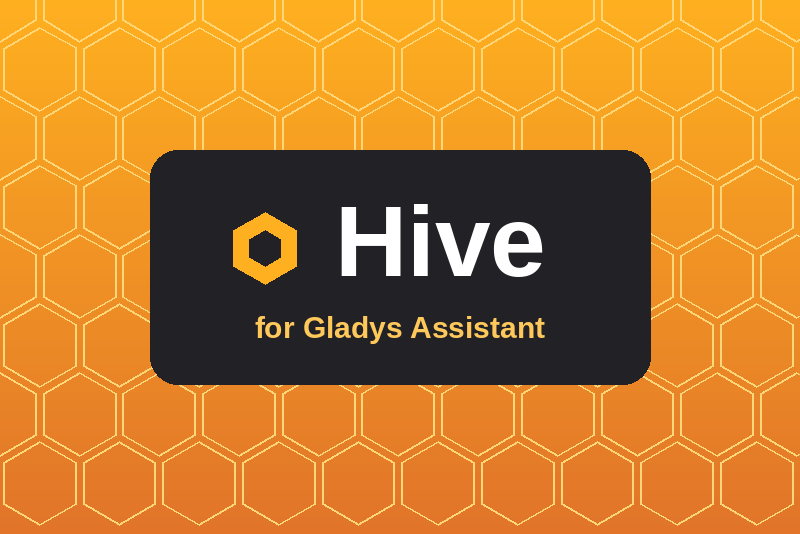

# Hive for Gladys Assistant

External integration for [Gladys Assistant](https://gladysassistant.com) that
brings the **Hive** smart home range (Centrica / British Gas) into Gladys:
heating, hot water, radiator valves, lights, plugs, motion and door/window
sensors, and the automations of the Hive app.



- **Cloud** integration (manifest `transports: ["cloud"]`): it uses the Hive
  cloud API, the one of the Hive apps.
- Gladys **5.1.0** or later (scene triggers, scene actions, widgets).
- English, French, German and Spanish.
- User documentation: [English](docs/en.md) · [Français](docs/fr.md) ·
  [Deutsch](docs/de.md) · [Español](docs/es.md).

## Features

| Hive product                    | Gladys device                                                  |
| ------------------------------- | -------------------------------------------------------------- |
| Active Heating / TRV zone       | Thermostat (temperature, target, mode, heating state, battery) |
| Hot water                       | Water heater (mode, boost, heating state)                      |
| Active Light (all three models) | Light (on/off, brightness, white temperature, colour)          |
| Active Plug                     | Switch (on/off, power)                                         |
| Motion sensor                   | Motion, temperature, battery                                   |
| Window / door sensor            | Opening, battery                                               |
| Hive action (automation)        | Switch enabling / disabling it                                 |

- **Scene triggers**: `motion_detected`, `contact_changed`, `boost_ended`,
  `connectivity_changed`, `battery_low`.
- **Scene actions**: `boost_heating`, `cancel_heating_boost`,
  `boost_hot_water`, `cancel_hot_water_boost`, `set_heating_mode`,
  `set_hot_water_mode`.
- **Widgets**: `hive_heating` (one zone, live temperatures, boost buttons) and
  `hive_home` (connection, hot water, lights, openings, offline devices, low
  batteries).

## How it works

Hive accounts live in an AWS Cognito user pool. The integration implements the
Cognito SRP login itself (native `BigInt` and `node:crypto`, no AWS SDK), the
SMS code step, then registers Gladys as a **remembered device**: later logins
prove the device instead of asking for a new code. The session renews with the
refresh token. Only the remembered device and the refresh token are stored, in
`/data`; the password stays in the Gladys configuration and is never logged.

The home is read with one call (`GET /nodes/all`) at the refresh interval of
the configuration (60 s by default); only the changed states are published,
and the transitions between two reads become scene events.

```
index.js                SDK wiring only
src/controller.js       session, cached home, refresh loop, commands
src/hive/srp.js         Cognito SRP maths (checked against amazon-cognito-identity-js)
src/hive/cognito.js     Cognito JSON API client
src/hive/auth.js        login flow: SRP, SMS code, remembered device, refresh
src/hive/api.js         Hive beekeeper API
src/hive/home.js        payload helpers: hardware, battery, schedules, colours
src/hive/store.js       session file in /data
src/devices/            one blueprint per Hive product family + registry
src/events.js           scene triggers (transitions between two reads)
src/scenes.js           scene actions
src/widgets.js          dashboard widgets
src/actions.js          Configuration screen buttons
src/i18n.js             status and action messages (en, fr, de, es)
```

## Development

```bash
npm install
npm test              # node --test, against a fake Hive cloud and the SDK's fake Gladys
npm run lint
npm run format:check
npx github:GladysAssistant/integration-store .   # store admission checks
```

The tests never touch the network: `test/helpers/fakeHive.js` emulates the SSO
page, a Cognito pool that **verifies** the SRP password and device proofs, and
the Hive API.

Run it against a local Gladys:

```bash
GLADYS_HOST_API_URL="http://localhost:1443" \
GLADYS_INTEGRATION_TOKEN="<token>" \
GLADYS_INTEGRATION_SELECTOR="hive" \
HIVE_SESSION_FILE=./data/hive-session.json \
LOG_LEVEL=debug npm start
```

## Release

Describe the changes under `## [Unreleased]` in [CHANGELOG.md](CHANGELOG.md),
then **Actions → Release → Run workflow** (`patch`, `minor` or `major`): the
workflow bumps the versions, tags, builds the multi-arch image
`ghcr.io/gboulvin/gladys-hive` and publishes the GitHub Release.

## Disclaimer

Not affiliated with nor endorsed by Hive or Centrica. Hive is a trademark of
its owner. The Hive cloud API is not public and may change.

## License

Apache-2.0
